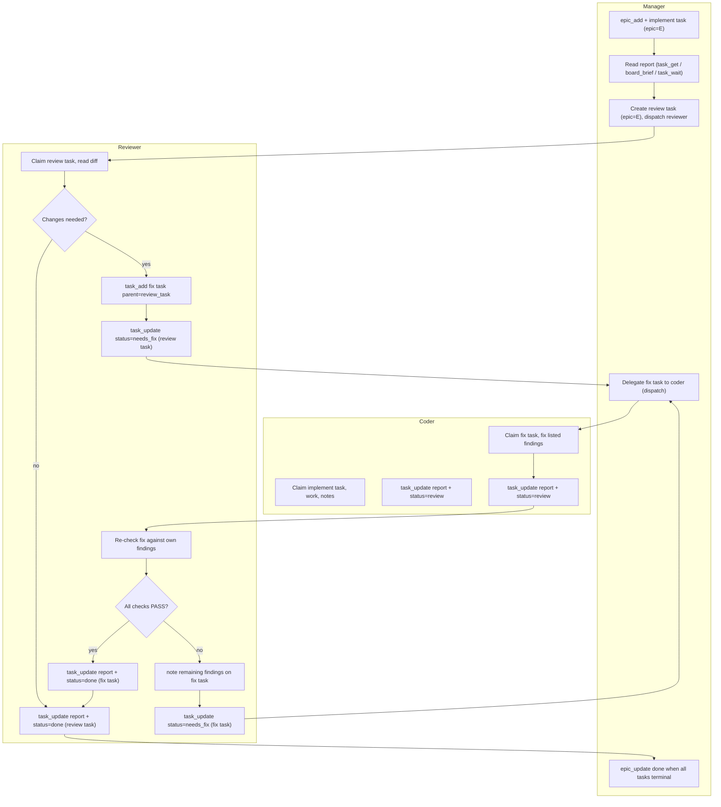
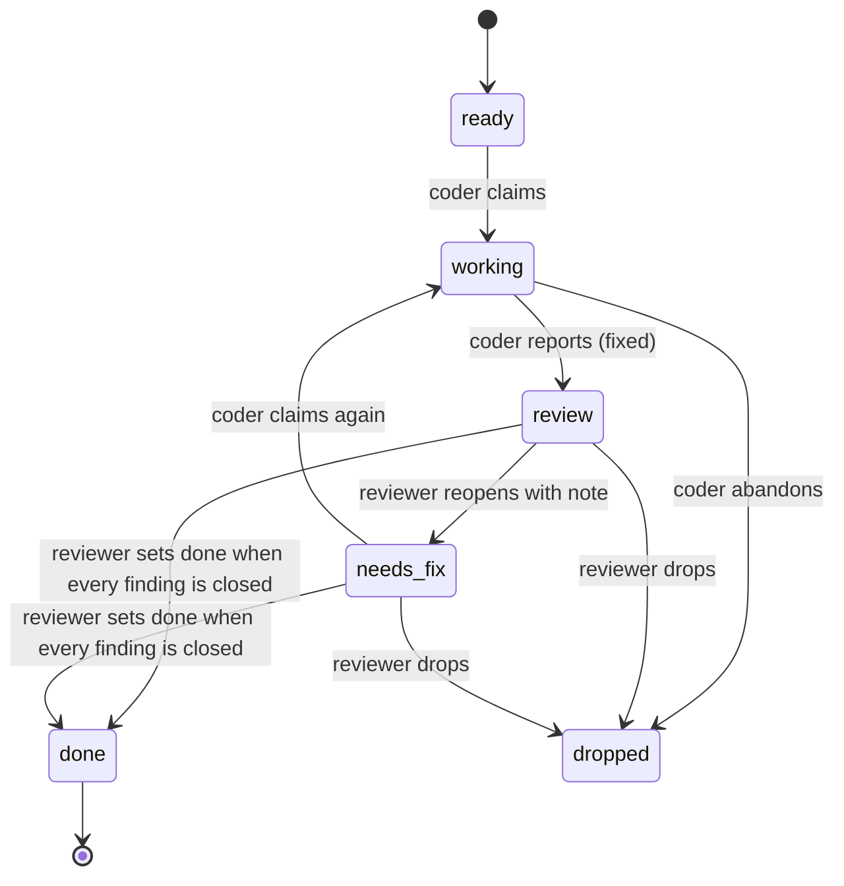

# Review loop

This document describes the review loop used by this project. It matches `src/schema.sql`; `PROTOCOL.md` steps 6–8 are stale (see Divergence).

## Topology

One `herdr` tab rooted in the repository. Two panes:

- **coder pane** (left): exports `AGENTBOARD_ACTOR=opencode-coder`
- **reviewer pane** (right): exports `AGENTBOARD_ACTOR=opencode-reviewer`

Each pane runs its own `agentboard` MCP server. The actor name is recorded in every event so the log names the writer.

> **Current setup**: two opencode panes, `AGENTBOARD_ACTOR=opencode-coder` / `opencode-reviewer`, because the Claude quota is exhausted; any coder/reviewer pair works.

## The loop

1. **Manager** creates an epic (`E<n>`) with `epic_add` and an implement task with `epic=E<n>`.
2. **Worker** (coder) claims the implement task, works, writes progress with `note`, then finishes with `task_update(report=..., status=review)`.
3. **Manager** reads the report (via `task_get` or `board_brief`, or `task_wait` for server-side blocking), creates a review task under the same epic, and dispatches the reviewer (`dispatch` to the reviewer pane).
4. **Reviewer** claims the review task and either:
   - Sets it `done` with a report (no changes needed), or
   - Files a fix task with `parent=<review task id>` (inherits the epic) and sets the review task `status=needs_fix`.
5. **Coder** claims the fix task, fixes the listed findings, writes `report` with the verdict per finding, and sets the fix task `status=review` (this is the "fixed" state; there is no `fixed` status).
6. **Reviewer** re-checks the fix against its own findings:
   - If all checks pass: sets the fix task `done` (report carries the evidence), then sets the review task `done`.
   - If findings remain: writes a `note` listing remaining findings on the fix task and sets the fix task `status=needs_fix` (the review task stays `needs_fix`).
7. Loop returns to step 5 until the reviewer closes the review task.
8. **Manager** closes the epic once every task is terminal (`done` or `dropped`) with `epic_update(status=done)`.

Only the reviewer sets a fix task `done`. The coder never sets a fix task `done` and never closes a review task.

### Divergence from PROTOCOL.md

`PROTOCOL.md` steps 6–8 are stale: step 7 still lets the fixer set the fix task `done`. The authoritative rule is in this document: the fix task reaches `done`, and only the reviewer sets it (the coder stops at `review`).

## Fix-task lifecycle

```
ready → working (coder claims) → review (coder reports; "fixed" state) → needs_fix (reviewer reopens with note) → working (coder claims again) → done (reviewer sets)
```

States are exactly those in `src/schema.sql`:

```
ready | working | blocking | needs_fix | review | done | dropped
```

The `review` state on a fix task means "fixed, awaiting re-check". The `needs_fix` state means "re-check found remaining work". The reviewer drives the transition from `review` to `done` (on the fix task) or `needs_fix` (on the fix task), and subsequently closes the review task `done`. The coder drives `ready` → `working` → `review`.

## Where text lives

| Field      | Purpose                                               |
|------------|-------------------------------------------------------|
| `description` | Context: repo path, files, situation, constraints |
| `goal`        | How to do it + definition of done                   |
| `report`      | Outcome: findings, verdict per finding, evidence    |
| `note`        | Last progress line (history lives in events)        |

No `NOTES.md` / `STATUS.md` files. The board is the only status channel.

## Diagrams

### Loop flowchart (with reopen edge)



### Fix-task state diagram



## Wait mechanism

- **Board-level wait**: `task_wait` (MCP) or `agentboard wait` (CLI) blocks server-side until watched tasks match a status/kind filter. Returns only the delta. No polling by hand.
- **Pane-level watch**: `agentboard tail` / `session_tail` are **tmux-only** on this build. For herdr panes, use `herdr pane read <pane_id>` or `herdr agent read <name>` to watch the other agent.
- Never read the SQLite file directly. The board and the pane are the two authoritative sources.

## Status reference

From `src/schema.sql` line 27:

```sql
status TEXT NOT NULL DEFAULT 'ready', -- ready|working|blocking|needs_fix|review|done|dropped
```

Aliases accepted on input (matching `src/store/mod.rs` `norm()`): `running`→`working`, `started`→`working`, `blocked`→`blocking`, `triage`→`ready`, `need fix`/`needs-fix`/`need-fix`/`need_fix`/`needs fix`/`fix`→`needs_fix`.