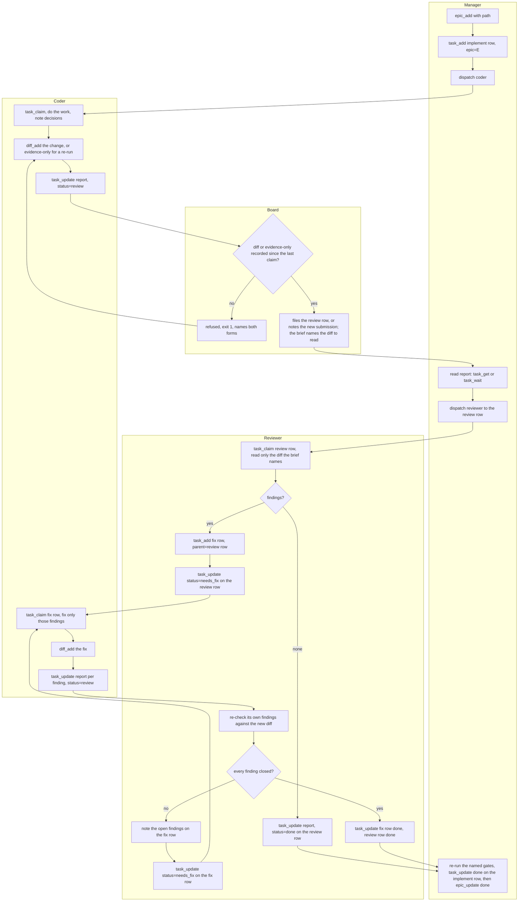
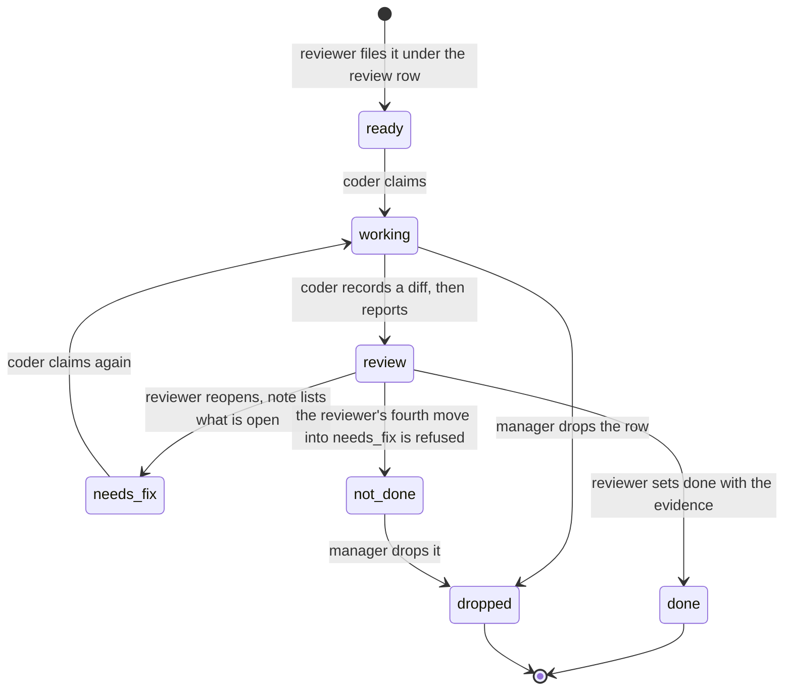
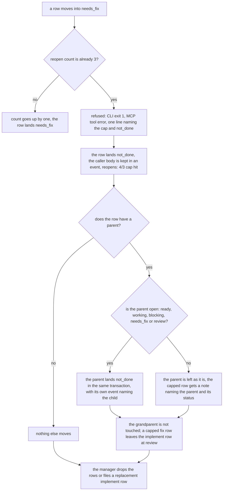

# Workflow

The loop every piece of reviewable work runs. The prose that governs it is
[PROTOCOL.md](../PROTOCOL.md); these diagrams are the same rules in picture form, kept
here so the prose and the pictures cannot drift apart. This page owns every diagram:
other pages link here and carry none.

One epic holds a chain of exactly three levels: an implement row, its review row (a child
of the implement row) and a fix row (a child of the review row). There is no fourth level.
The board files the review row itself when the implement row moves to `review`, and it
refuses that move unless a submission was recorded since the last claim: a diff, or an evidence-only row for a re-run round whose tree did not change. A review that finds
problems files one fix row, reused across rounds. The coder stops at `review`; only the
reviewer sets a fix row `done` and closes the review row; only the manager closes the
implement row.

## The loop

## Fix-row lifecycle

## The reopen cap

## Who moves what

| Status move | Who |
|---|---|
| `ready`/`needs_fix` -> `working` -> `review` (a move to `review` needs a diff or evidence-only submission since the last claim) | coder |
| `review` -> `done` or `needs_fix`, on a fix row or a review row | reviewer |
| `ready` (re-arm a crashed row), `dropped`, `done` on the implement row, epic status, clearing a `not_done` row | manager |
| `not_done`, and filing the review row | the board |

`review` on a fix row reads as "fixed, waiting for the reviewer". There is no `fixed`
status. A fix row reaching `done` is the reviewer's signature, and its `report` carries
the evidence.

Closing an epic once every row is `done` or `dropped` is the manager's policy, not a
guard: `epic_update` does not check the rows, so a `not_done` row blocks closure only
because the manager does not close over it.
