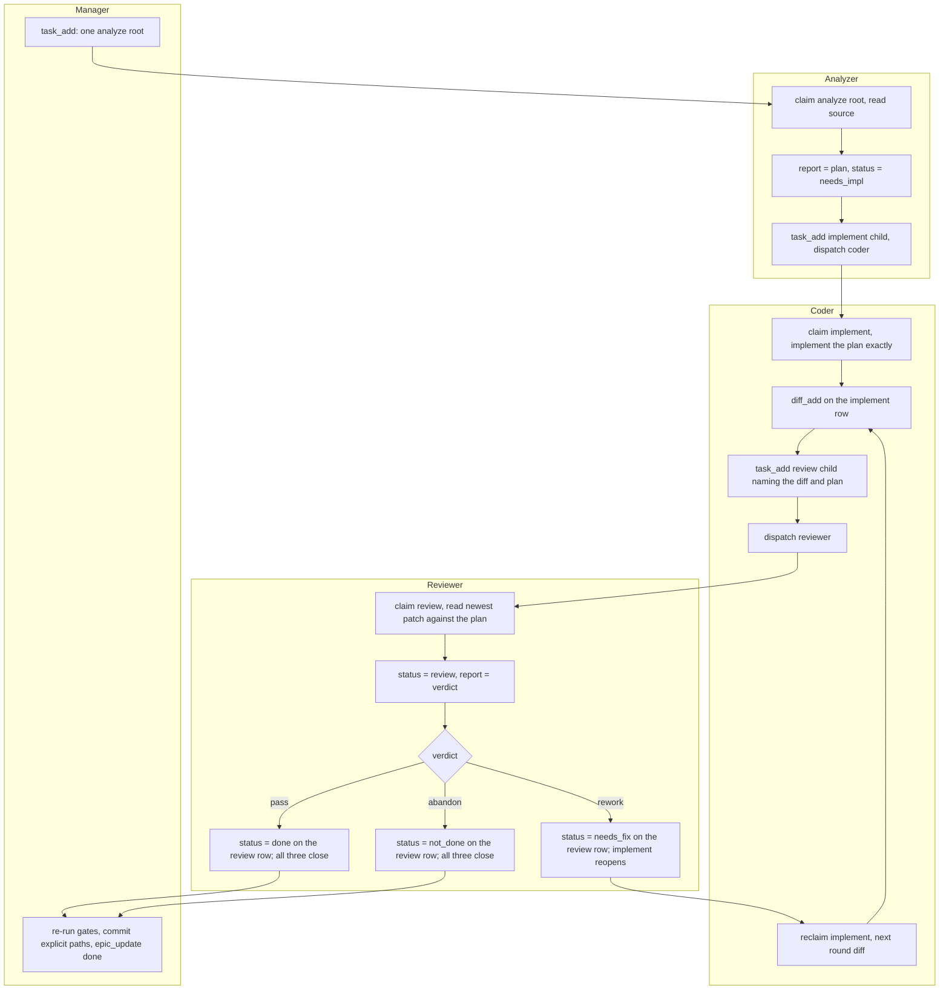

# Workflow

The primary loop is a chain of exactly three rows: **analyze -> implement ->
review**. [PROTOCOL.md](../PROTOCOL.md) is the authority for the wire surface;
[three-task-chain.md](three-task-chain.md) is the design note and owns the close,
reopen and failure rules. This page owns the diagram and the status-ownership
table. Other pages link here for the picture; they do not restate it.

## The three-row chain

The coder files the review child; its creation atomically publishes the
implement row as `needs_review`. For rework instructions, see the
[playbook](../skills/agentboard-manager/workflow.md#one-round).

## Who moves what

| Status move | Who |
|---|---|
| `ready` or `working` -> `needs_impl` | analyzer |
| `ready`, `needs_fix` or `needs_impl` -> `working` -> `needs_review` | coder, after claiming; a claimed `working` row publishes directly when it files the review child (the move needs a recorded submission since the latest claim) |
| The review row's `ready` -> `review` -> `done`, `not_done` or `needs_fix` | reviewer |
| The atomic three-row close, the rejection, and `not_done` when the cap bites | the board, through those review-row moves |
| Filing the analyze root, dispatch rescue, epic status, commit after the owner agrees | manager |

The coder never closes a chain and never sets `done` on any row. The reviewer
never edits the tree and never files a row. The manager never files an implement
or review row, and never moves a worker's status for it.

## The legacy chain

Older `implement -> review -> fix` chains keep their own three-level behavior and
are documented under the legacy section of [PROTOCOL.md](../PROTOCOL.md). Do not
use the legacy fix row for work started under the primary loop: the primary loop
reopens its implement row.
