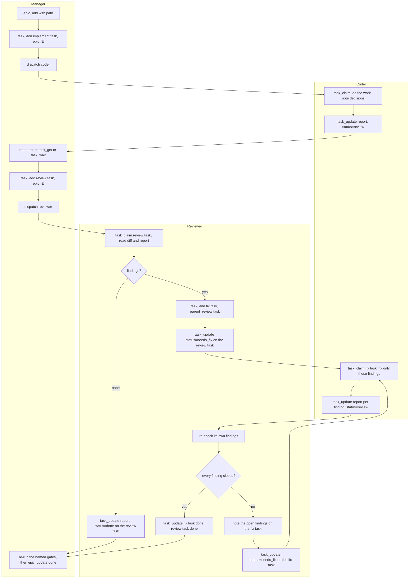
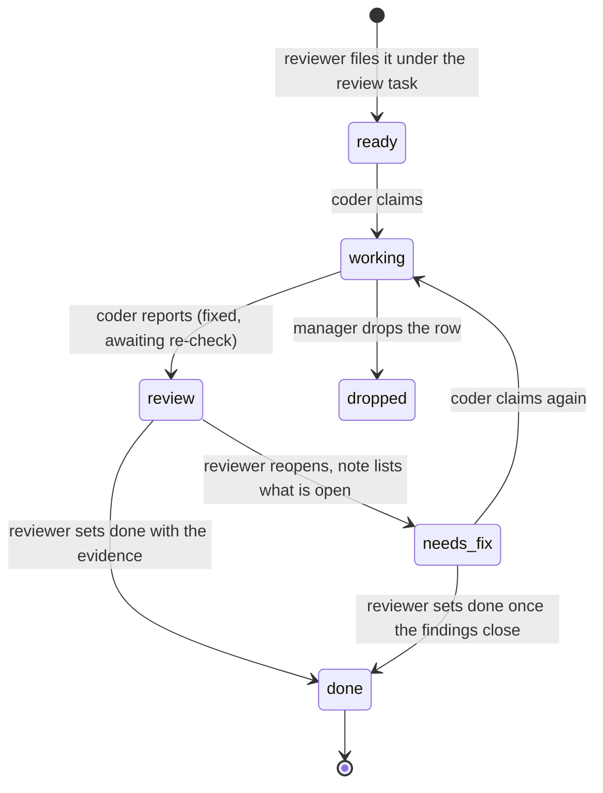

# Workflow

The loop every piece of reviewable work runs. The prose that governs it is
[PROTOCOL.md](../PROTOCOL.md); these diagrams are the same rules in picture form, kept
here so the prose and the pictures cannot drift apart.

One epic holds an implement task and a review task. A review that finds problems files a
fix task as a child of the review task. The coder stops at `review`; only the reviewer
sets a fix task `done`, and only the reviewer closes the review task.

## The loop

## Fix-task lifecycle

## Who moves what

| Status move | Who |
|---|---|
| `ready`/`needs_fix` -> `working` -> `review` | coder |
| `review` -> `done` or `needs_fix`, on a fix task or a review task | reviewer |
| `ready` (re-arm a crashed task), `dropped`, `done` on the implement task, epic status | manager |

`review` on a fix task reads as "fixed, waiting for the reviewer". There is no `fixed`
status. A fix task reaching `done` is the reviewer's signature, and its `report` carries
the evidence.
